# نمودار وابستگی و معماری اجرایی Zenith (`#108`)

> این فایل **خودکار** از گراف واقعی importها تولید می‌شود (dependency-cruiser).
> ویرایش دستی بی‌فایده است: گیت CI آن را کهنه تشخیص می‌دهد.
> مقیاس فعلی: **50 پکیج** و **194 یال** یکتا (fold‌شده در سطح پکیج).

## نمودار (Mermaid)

```mermaid
graph LR
  subgraph L0["L0"]
    direction TB
    cache["cache"]
    errors["errors"]
    jalali["jalali"]
    logger["logger"]
    scheduler["scheduler"]
    schema["schema"]
    security["security"]
    shared["shared"]
    storage["storage"]
  end
  subgraph L1["L1"]
    direction TB
    dependency_graph["dependency-graph"]
    devtools_core["devtools-core"]
    expressions["expressions"]
    state["state"]
  end
  subgraph L2["L2"]
    direction TB
    actions["actions"]
    auth["auth"]
    auth_oauth["auth-oauth"]
    charts["charts"]
    components["components"]
    data["data"]
    data_table["data-table"]
    error_boundary["error-boundary"]
    events["events"]
    feature_flags["feature-flags"]
    form["form"]
    http["http"]
    i18n["i18n"]
    icons["icons"]
    notifications["notifications"]
    permission["permission"]
    resource["resource"]
    router["router"]
    store["store"]
    suspense["suspense"]
    theme["theme"]
    transition["transition"]
    virtual_list["virtual-list"]
  end
  subgraph L3["L3"]
    direction TB
    runtime["runtime"]
    runtime_core["runtime-core"]
    ssr["ssr"]
  end
  subgraph L4["L4"]
    direction TB
    crud["crud"]
    devtools["devtools"]
    service_worker["service-worker"]
    stateful["stateful"]
    testing["testing"]
  end
  subgraph L5["L5"]
    direction TB
    zenith["zenith"]
  end
  subgraph TOOLING["TOOLING"]
    direction TB
    cli["cli"]
    compiler["compiler"]
    language_server["language-server"]
    vite_plugin["vite-plugin"]
    vscode_extension["vscode-extension"]
  end
  actions --> errors
  actions --> logger
  auth --> errors
  auth --> logger
  auth --> schema
  auth --> state
  auth --> storage
  auth_oauth --> errors
  auth_oauth --> state
  cache --> errors
  cache --> shared
  charts --> schema
  charts --> shared
  charts --> state
  cli --> expressions
  compiler --> dependency_graph
  components --> cache
  components --> errors
  components --> expressions
  components --> logger
  crud --> actions
  crud --> errors
  crud --> logger
  crud --> permission
  crud --> resource
  crud --> runtime
  crud --> state
  data --> cache
  data --> errors
  data --> expressions
  data --> logger
  data --> state
  data_table --> state
  dependency_graph --> expressions
  devtools --> components
  devtools --> devtools_core
  devtools --> errors
  devtools --> logger
  devtools --> state
  devtools_core --> errors
  devtools_core --> schema
  devtools_core --> state
  error_boundary --> errors
  error_boundary --> logger
  error_boundary --> state
  events --> actions
  events --> error_boundary
  events --> errors
  events --> expressions
  events --> logger
  events --> scheduler
  events --> state
  expressions --> cache
  expressions --> errors
  feature_flags --> errors
  feature_flags --> state
  feature_flags --> storage
  form --> errors
  form --> logger
  form --> state
  http --> cache
  http --> errors
  http --> schema
  http --> state
  i18n --> cache
  i18n --> errors
  i18n --> jalali
  i18n --> logger
  i18n --> schema
  i18n --> state
  icons --> security
  jalali --> errors
  jalali --> shared
  logger --> errors
  logger --> shared
  notifications --> errors
  notifications --> shared
  notifications --> state
  permission --> errors
  permission --> logger
  permission --> security
  permission --> state
  resource --> cache
  resource --> errors
  resource --> expressions
  resource --> logger
  resource --> state
  router --> cache
  router --> logger
  router --> state
  runtime --> actions
  runtime --> auth
  runtime --> components
  runtime --> data
  runtime --> devtools
  runtime --> error_boundary
  runtime --> errors
  runtime --> events
  runtime --> expressions
  runtime --> jalali
  runtime --> logger
  runtime --> notifications
  runtime --> resource
  runtime --> router
  runtime --> runtime_core
  runtime --> scheduler
  runtime --> schema
  runtime --> security
  runtime --> state
  runtime --> storage
  runtime --> suspense
  runtime --> transition
  runtime_core --> errors
  runtime_core --> expressions
  runtime_core --> logger
  runtime_core --> scheduler
  runtime_core --> schema
  runtime_core --> security
  runtime_core --> shared
  runtime_core --> state
  scheduler --> errors
  schema --> errors
  schema --> shared
  security --> logger
  security --> shared
  service_worker --> errors
  service_worker --> logger
  service_worker --> schema
  shared --> errors
  ssr --> errors
  ssr --> logger
  ssr --> runtime
  ssr --> scheduler
  ssr --> state
  state --> errors
  state --> logger
  state --> scheduler
  stateful --> actions
  stateful --> errors
  stateful --> logger
  stateful --> runtime
  stateful --> state
  storage --> errors
  storage --> logger
  storage --> shared
  store --> errors
  store --> state
  suspense --> error_boundary
  suspense --> errors
  suspense --> security
  suspense --> state
  testing --> errors
  testing --> scheduler
  testing --> state
  theme --> errors
  theme --> schema
  theme --> state
  theme --> storage
  transition --> errors
  transition --> logger
  transition --> shared
  virtual_list --> errors
  virtual_list --> expressions
  virtual_list --> state
  vite_plugin --> compiler
  vite_plugin --> expressions
  vite_plugin --> schema
  zenith --> actions
  zenith --> auth
  zenith --> cache
  zenith --> components
  zenith --> error_boundary
  zenith --> errors
  zenith --> events
  zenith --> form
  zenith --> http
  zenith --> i18n
  zenith --> jalali
  zenith --> logger
  zenith --> notifications
  zenith --> resource
  zenith --> router
  zenith --> runtime_core
  zenith --> scheduler
  zenith --> schema
  zenith --> security
  zenith --> shared
  zenith --> ssr
  zenith --> state
  zenith --> storage
  zenith --> store
  zenith --> suspense
  zenith --> testing
  zenith --> transition
```



## لایه‌ها

| لایه | تعداد | پکیج‌ها |
|---|---|---|
| **L0** | 9 | `cache`, `errors`, `jalali`, `logger`, `scheduler`, `schema`, `security`, `shared`, `storage` |
| **L1** | 4 | `dependency-graph`, `devtools-core`, `expressions`, `state` |
| **L2** | 28 | `a11y`, `actions`, `analytics`, `auth`, `auth-oauth`, `charts`, `components`, `data`, `data-table`, `error-boundary`, `events`, `feature-flags`, `form`, `head`, `http`, `i18n`, `icons`, `notifications`, `permission`, `realtime`, `resource`, `router`, `store`, `suspense`, `theme`, `transition`, `ui`, `virtual-list` |
| **L3** | 3 | `runtime`, `runtime-core`, `ssr` |
| **L4** | 8 | `adapter-edge`, `adapter-node`, `crud`, `devtools`, `service-worker`, `ssg`, `stateful`, `testing` |
| **L5** | 1 | `zenith` |
| **TOOLING** | 13 | `cli`, `codemod`, `compiler`, `create-zenith`, `devtools-extension`, `eslint-plugin`, `language-server`, `mock`, `templates`, `testing-e2e`, `unplugin-zenith`, `vite-plugin`, `vscode-extension` |

> نقشهٔ رسمی و قاعدهٔ مجاز بودن یال‌ها در [docs/ARCHITECTURE-LAYERS.md](./ARCHITECTURE-LAYERS.md) است؛ اجرای گیت با `npm run deps` انجام می‌شود و ADR آن [ADR-0005](./adr/0005-layered-monorepo.md) است.

## یال‌های رو به بالا (نقض لایه)

| از | به | وضعیت |
|---|---|---|
| `runtime` | `devtools` | استثنای مستند (حذف در ۲.۰) |

## هستهٔ reactive (چطور یک تغییر به DOM می‌رسد)

مسیر یک به‌روزرسانی، از خواندن تا پچ گره — بدون Virtual DOM (ADR-0001, ADR-0002):

1. **خواندن (pull):** قالب/DOM با `signal.get()` یا از طریق دایرکتیو
   (`zen-text`, `zen-bind`, `zen-if`, `zen-for`) مقدار را می‌خواند. هر خواندن،
   effect مالک را به‌عنوان مشترک آن سیگنال ثبت می‌کند.
2. **نوشتن (push زمان‌بندی‌شده):** `signal.set(v)` مقدار را عوض می‌کند و
   effectهای وابسته را در صف `@zenith/scheduler` می‌گذارد؛ چند `set` در یک
   tick = یک رندر (batch داخلی، بدون `batch()` در API).
3. **کولسینگ/اولویت:** زمان‌بند در یک microtask/rAF صف را اجرا می‌کند؛
   `flushSync()` مرز قطعی تست/SSR است و `nextTick()` انتظار غیرمسدودکننده.
4. **پچ گره:** هر bind فقط همان گرهٔ DOM را به‌روزرسانی می‌کند
   (`textContent`, attribute, جای درج). هیچ diffی روی درخت اجرا نمی‌شود.
5. **عبارت‌ها:** رشتهٔ `zen-*=...` با `@zenith/expressions` به AST تبدیل و در
   sandbox تفسیر می‌شود (ADR-0004) — بدون `eval`/`new Function`.
6. **مالکیت/آزادسازی:** هر effect/دایرکتیو در درخت Owner ثبت می‌شود؛
   `dispose()` یا `Cleanup` برگشتی همان شاخه را می‌بندد (ADR-0007).
7. **SSR:** همان مسیر روی سرور اجرا می‌شود
   (`renderToString`/`renderToReadableStream`) و کلاینت فقط state سریالایزشده
   را hydrate می‌کند (ADR-0015).

وابستگی‌های این زنجیره به‌ترتیب لایه‌ها (و دلیل هر یال در جدول لایه‌ها):

- `@zenith/state` (L1) → `@zenith/scheduler` (L0) → `@zenith/errors`/`@zenith/shared` (L0)
- `@zenith/runtime-core` (L3) → `state`, `expressions`, `compiler`(tooling? نه: فقط رانتایم DOM): `runtime-core` روی L1/L2 بنا شده و مرز مشترک کلاینت/SSR است (DEC-025)
- `@zenith/testing` (L4) → همهٔ لایه‌های پایین‌تر برای harness ایزوله + `resetForTesting()` (ADR-0012)

## چطور این فایل به‌روز می‌شود

```bash
node scripts/generate-architecture-graph.mjs          # بازتولید
node scripts/generate-architecture-graph.mjs --check  # گیت تازگی (CI: job deps)
npm run deps:graph                                    # SVG کامل Graphviz → artifacts/
```

یال‌ها از گراف واقعی importها (dependency-cruiser با resolve به `src`؛
DEC-049 در `docs/decisions`) استخراج می‌شوند، نه از `package.json`؛ بنابراین
import عمیق یا یال پنهان هم دیده می‌شود. SVG آن در هر اجرای CI artifact می‌شود.
